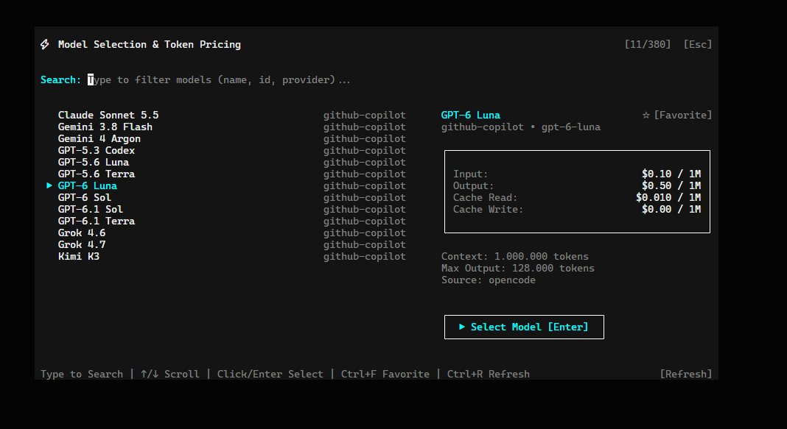

# OpenCode Model Pricing Plugin (`opencode-model-pricing`)

A plugin for **OpenCode v2** that displays detailed token costs for **Input**, **Output**, and **Cache** (read/write) per million tokens during model selection, featuring once-a-day synchronization, favorite model pinning, and an interactive Split-View interface in the OpenCode CLI (TUI).



---

## 🎯 Objectives

1. **Cost Transparency**: View real-time token pricing (input, output, and cache) before selecting an AI model.
2. **Intuitive CLI Split-View**: Replace the default selection picker with an expanded, balanced two-column modal:
   - **Left Pane**: Categorized, navigable model list with visual group dividers and selection indicator (`▶`).
   - **Right Pane (Secondary Area)**: Dedicated card detailing USD rates per 1M tokens, maximum context window, and generation limits.
3. **Favorites Support**: Pin preferred models with `Ctrl+F` so they automatically appear at the top of the list in a dedicated `★ FAVORITES` section.
4. **Bandwidth & Latency Efficiency (Daily Cache)**: Fetch the global pricing matrix once per day on the user's first OpenCode access, storing data locally in persistent storage.
5. **On-Demand Updates**: Provide a quick slash command (`/update-model-prices`) to immediately refresh pricing whenever new models or rates are announced.

---

## 🚀 Key Features

- **Single `/models` Command**: Cleanly replaces the built-in `model.list` command without duplicate entries in the slash autocomplete menu.
- **Detailed Pricing Metrics**:
  - `Input` per 1M tokens
  - `Output` per 1M tokens
  - `Cache Read` per 1M tokens
  - `Cache Write` per 1M tokens
  - `Context Window` & `Max Output` limits
- **Alphabetical Sorting**: Models within Favorites and each provider group are automatically sorted alphabetically by name.
- **Instant Search / Filtering**: Dedicated search input bar at the top of the modal (`Type to Search`) supporting real-time filtering by model name, ID, or provider.
- **Visual Provider Grouping**: Clean provider section headers without separation lines (`GitHub Copilot`, `OpenRouter`, `OpenCode`, etc.).
- **Hybrid Synchronization**: Seamlessly combines native OpenCode cost structures with public matrices from `models.dev` (covering OpenAI, Anthropic, Google Gemini, OpenRouter, DeepSeek, Qwen, etc.).
- **Keyboard & Mouse Support in Modal**:
  - `Type`: Direct typing into the search bar to filter models.
  - `Mouse Wheel`: Scroll up/down through the model list using the mouse wheel.
  - `Mouse Click`: Click to highlight, double-click or click `[ Select Model ]` to confirm. Click `[ Favorite ]` to toggle favorite status.
  - `↑` / `↓` or `Ctrl+P` / `Ctrl+N`: Navigate through filtered models.
  - `PageUp` / `PageDown`: Jump across batches of models.
  - `Enter`: Select the highlighted model for the active session and close the dialog.
  - `Ctrl + F`: Toggle the highlighted model as **Favorite (★)** (pinned to the top group).
  - `Ctrl + R`: Force real-time price synchronization directly from within the modal.
  - `Esc`: Clear search filter, or close the dialog if the search query is empty.

---

## 📦 Installation

### 1. Place the plugin directory

Ensure the `opencode-model-pricing` folder is located in your OpenCode plugins directory (default is `~/.config/opencode/plugins/`):

```bash
# Windows (PowerShell)
cd $env:USERPROFILE\.config\opencode\plugins\
# Linux / macOS
cd ~/.config/opencode/plugins/
```

### 2. Register in configuration

Open your global `opencode.jsonc` file (`~/.config/opencode/opencode.jsonc`) and add the plugin path to the `"plugins"` array:

```jsonc
{
  "$schema": "https://opencode.ai/config.json",
  "plugins": [
    "./plugins/opencode-model-pricing"
  ]
}
```

> **Tip**: OpenCode v2 watches configuration and plugin files automatically. If your terminal is already running, type `/reload` to apply changes immediately.

---

## 💻 Commands

| Command | Description |
|---|---|
| `/models` | Opens the wide split-screen modal with the model list on the left and input/output/cache rates in the secondary details area on the right. |
| `/update-model-prices` | Forces an immediate online fetch and update of the pricing table, persisting values to local storage. |

---

## 📁 Project Structure

```text
opencode-model-pricing/
├── package.json        # Plugin manifest (exports for server, tui, and rpc)
├── tsconfig.json       # TypeScript and JSX configuration for OpenTUI/SolidJS
├── README.md           # Documentation and usage guide
└── src/
    ├── images/         # UI preview screenshots and assets
    │   └── model-window.png
    ├── rpc.ts          # RPC contract with Standard Schema for inter-process communication
    ├── pricing.ts      # Data fetching, normalization, and USD formatting
    ├── index.ts        # OpenCode server daemon: daily sync, storage, and slash commands
    └── tui.tsx         # TUI (CLI) interface: xlarge split-view modal and keymaps
```

---

## 📄 License

MIT License

Copyright (c) 2026 OpenCode Model Pricing Plugin Contributors

Permission is hereby granted, free of charge, to any person obtaining a copy
of this software and associated documentation files (the "Software"), to deal
in the Software without restriction, including without limitation the rights
to use, copy, modify, merge, publish, distribute, sublicense, and/or sell
copies of the Software, and to permit persons to whom the Software is
furnished to do so, subject to the following conditions:

The above copyright notice and this permission notice shall be included in all
copies or substantial portions of the Software.

THE SOFTWARE IS PROVIDED "AS IS", WITHOUT WARRANTY OF ANY KIND, EXPRESS OR
IMPLIED, INCLUDING BUT NOT LIMITED TO THE WARRANTIES OF MERCHANTABILITY,
FITNESS FOR A PARTICULAR PURPOSE AND NONINFRINGEMENT. IN NO EVENT SHALL THE
AUTHORS OR COPYRIGHT HOLDERS BE LIABLE FOR ANY CLAIM, DAMAGES OR OTHER
LIABILITY, WHETHER IN AN ACTION OF CONTRACT, TORT OR OTHERWISE, ARISING FROM,
OUT OF OR IN CONNECTION WITH THE SOFTWARE OR THE USE OR OTHER DEALINGS IN THE
SOFTWARE.
