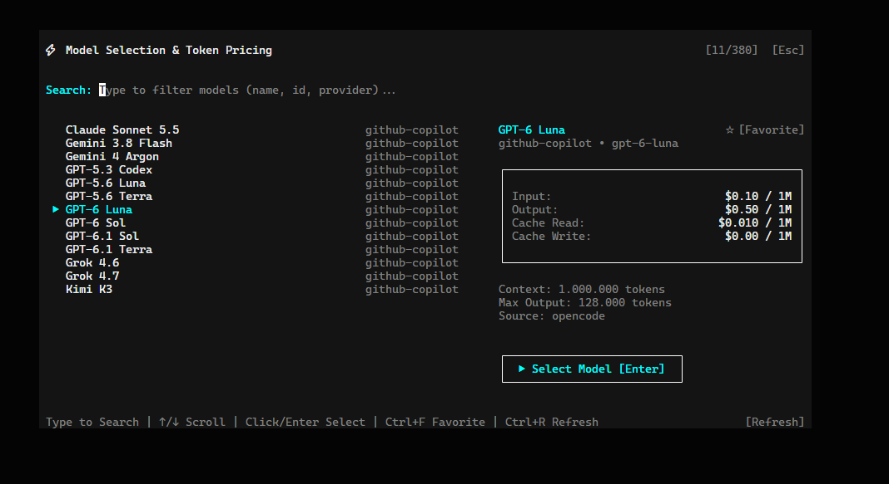

# OpenCode Model Pricing Plugin (`opencode-model-pricing`)

A plugin for **OpenCode v2** that displays detailed token costs for **Input**, **Output**, and **Cache** (read/write) per million tokens during model selection, featuring once-a-day synchronization, favorite model pinning, name/input-price sorting, and an interactive Split-View interface in the OpenCode CLI (TUI).

> Repository/directory: `opencode-tui-model-price` · npm package: `opencode-model-pricing`.



---

## ⚡ Quick start

```bash
opencode plugin add opencode-model-pricing
```

Then run `/reload` inside OpenCode and open `/models-price`. See [Installation](#-installation) for the Git and manual alternatives and troubleshooting.

---

## 🎯 Objectives

1. **Cost Transparency**: View real-time token pricing (input, output, and cache) before selecting an AI model.
2. **Intuitive CLI Split-View**: Replace the default selection picker with an expanded, balanced two-column modal:
   - **Left Pane**: Categorized, navigable model list with visual group dividers and selection indicator (`▶`).
   - **Right Pane (Secondary Area)**: Dedicated card detailing USD rates per 1M tokens, maximum context window, and generation limits.
3. **Favorites Support**: Pin preferred models with `Ctrl+F` so they automatically appear at the top of the list in a dedicated `★ FAVORITES` section.
4. **Bandwidth & Latency Efficiency (Daily Cache)**: Fetch the global pricing matrix once per day on the user's first OpenCode access, storing data locally in persistent storage.
5. **On-Demand Updates**: Refresh pricing on demand from inside the dialog (`Ctrl+R` or the `[Refresh]` button) whenever new models or rates are announced — there is no slash command for this anymore.

---

## 🚀 Key Features

- **Dedicated `/models-price` Command**: Opens the pricing/favorites split-view without duplicate entries in the slash autocomplete menu; the built-in `/models` keeps its native OpenCode behavior (no override).
- **Detailed Pricing Metrics**:
  - `Input` per 1M tokens
  - `Output` per 1M tokens
  - `Cache Read` per 1M tokens
  - `Cache Write` per 1M tokens
  - `Context Window` & `Max Output` limits
- **Sort Order Toggle**: Models within Favorites and each provider group are listed alphabetically by name by default; `Ctrl+S` (or the `[Sort: Name]` / `[Sort: Price ↑]` footer button) switches the ordering to lowest input price (USD per 1M tokens, ascending), with name as the tie-breaker.
- **Tall Split-View**: The modal occupies 70% of the terminal height, and the visible model window is computed from the available rows, so a taller terminal shows more models instead of empty space.
- **Instant Search / Filtering**: Dedicated search input bar at the top of the modal (`Type to Search`) supporting real-time filtering by model name, ID, or provider.
- **Visual Provider Grouping**: Clean provider section headers without separation lines (`GitHub Copilot`, `OpenRouter`, `OpenCode`, etc.).
- **Hybrid Synchronization**: Seamlessly combines native OpenCode cost structures with public matrices from `models.dev` (covering OpenAI, Anthropic, Google Gemini, OpenRouter, DeepSeek, Qwen, etc.).
- **Keyboard & Mouse Support in Modal**:
  - **Footer**: the first line shows the interaction hints plus the clickable `[Refresh]` and `[Sort: ...]` actions; the second line lists the keyboard shortcuts.
  - `Type`: Direct typing into the search bar to filter models.
  - `Mouse Wheel`: Scroll up/down through the model list using the mouse wheel.
  - `Mouse Click`: Click to highlight, then double-click to confirm. Click `[ Favorite ]` to toggle favorite status, `[Refresh]` to sync prices and `[Sort: ...]` to change the ordering.
  - `↑` / `↓` or `Ctrl+P` / `Ctrl+N`: Navigate through filtered models.
  - `PageUp` / `PageDown`: Jump across batches of models.
  - `Enter`: Applies the highlighted model to the session that owns the open prompt, then closes the dialog only after OpenCode confirms the switch. With no active session the dialog is browse-only and refuses the selection with a message (the dialog stays open).
  - The model currently used by the prompt is preselected when the dialog opens (and stays highlighted until you move with the arrow keys); the preselection always follows the prompt's active model.
  - `Ctrl + F`: Toggle the highlighted model as **Favorite (★)** (pinned to the top group).
  - `Ctrl + S` or the `[Sort: Name]` / `[Sort: Price ↑]` footer button: Toggle the list ordering between **Name** (default) and **lowest input price** (ascending, tie-broken by name).
  - `Ctrl + R`: Force real-time price synchronization directly from within the modal.
  - `Esc`: Clear search filter, or close the dialog if the search query is empty.

---

## 📦 Installation

The plugin ships as an OpenCode package (`opencode-model-pricing`): there is no build step — the TypeScript entrypoints under `src/` are loaded directly.

### 1. npm registry (recommended)

```bash
opencode plugin add opencode-model-pricing
```

This installs `opencode-model-pricing@1.0.0` into the OpenCode plugin cache and registers it in your **global** configuration (`~/.config/opencode/opencode.jsonc`):

```jsonc
{
  "plugins": ["opencode-model-pricing"]
}
```

Useful follow-ups:

```bash
opencode plugin list                              # confirm the plugin is registered
opencode plugin update opencode-model-pricing     # pick up new releases
opencode plugin remove opencode-model-pricing     # uninstall
```

> Run `/reload` inside OpenCode after installing or removing the plugin.

> **Note:** if your `~/.npmrc` sets `min-release-age` (for example `min-release-age=7`), npm and OpenCode refuse versions published less than that many days ago. Either wait for the release to age or install with `npm_config_min_release_age=0 opencode plugin add opencode-model-pricing`.

### 2. Git repository

Use this to track the default branch instead of npm releases; it is also immune to the `min-release-age` guard:

```bash
opencode plugin add rodabarbosa/opencode-tui-model-price
```

`./install.sh` is a thin wrapper around the same command:

```bash
./install.sh                                    # opencode plugin add rodabarbosa/opencode-tui-model-price
./install.sh opencode-model-pricing             # any npm registry or Git specifier
```

### 3. Manual installation (local checkout)

Use this only when you want to run a local copy instead of the installed package.

**a. Place the plugin directory.** Ensure the `opencode-tui-model-price` folder is located in your OpenCode plugins directory (default is `~/.config/opencode/plugins/`):

```bash
# Windows (PowerShell)
cd $env:USERPROFILE\.config\opencode\plugins\
# Linux / macOS
cd ~/.config/opencode/plugins/
```

**b. Register in configuration.**

Open your global `opencode.jsonc` file (`~/.config/opencode/opencode.jsonc`) and add the plugin path to the `"plugins"` array:

```jsonc
{
  "$schema": "https://opencode.ai/config.json",
  "plugins": [
    "./plugins/opencode-tui-model-price"
  ]
}
```

> **Tip**: OpenCode v2 watches configuration and plugin files automatically. If your terminal is already running, type `/reload` to apply changes immediately.

---

## 💻 Commands

| Command | Description |
|---|---|
| `/models-price` | Opens the wide split-screen modal with the model list on the left and input/output/cache rates in the secondary details area on the right. |

> `/models` remains the native OpenCode model picker — this plugin does not override it.

---

## 🎛️ Model Switching

Selecting a model is a real switch, not just a UI highlight:

1. The dialog captures the session that owns the prompt when it opens
   (`context.ui.router.current()`), never the first entry of the session list.
2. `Enter` (or a double-click on the highlighted model) calls `session.switchModel`
   with the catalog `providerID` and `modelID`.
3. The plugin refreshes the session cache and checks the committed
   `session.model`; it only closes and reports success after the model matches.
4. On failure the dialog stays open and shows the error, so the previous model
   remains untouched. Selecting the already active model does not round-trip.

**Selection requires an active session.** The active session is captured from
the prompt route when the dialog opens. Without one, pricing is browse-only:
navigation, search, favorites and price details stay available, but
`Enter` (or a double-click) is refused with a message and the dialog stays open.

Changing the model inside a session resets the variant to the model default;
selecting the current model keeps it. Aliased models are switched by their
catalog ID (`id`), not by the provider-facing `modelID`.

---

## 📁 Project Structure

```text
opencode-tui-model-price/
├── AGENTS.md           # Plugin conventions and invariants for AI agents
├── install.sh          # Installs the plugin through the OpenCode CLI
├── package.json        # Plugin manifest (exports for server, tui, and rpc)
├── tsconfig.json       # TypeScript and JSX configuration for OpenTUI/SolidJS
├── README.md           # Documentation and usage guide
├── tests/
│   ├── model-selection.test.ts            # Unit tests for session/model helpers
│   └── pricing-sort.test.ts               # Unit tests for price lookup and list ordering
└── src/
    ├── images/         # UI preview screenshots and assets
    │   └── model-window.png
    ├── rpc.ts          # RPC contract with Standard Schema for inter-process communication
    ├── pricing.ts      # Price fetching/normalization, USD formatting, price lookup and sorting
    ├── model-selection.ts  # Pure helpers: active-session resolution and model identifiers
    ├── index.ts        # OpenCode server daemon: daily sync, storage, RPC
    └── tui.tsx         # TUI (CLI) split-view modal: 70% height, sort toggle, favorites, keymaps
```

## 🧪 Development

```bash
npm test          # node --test tests/
```

The helper modules (`src/model-selection.ts` and `src/pricing.ts`) are
intentionally free of OpenTUI/Solid imports so they can be tested without the
TUI runtime. `AGENTS.md` documents the layout and behavior invariants the plugin
must keep (single `/models-price` command, 70% dialog height, footer layout,
sort default, pricing cache keys).

---

## 📄 License

MIT License

Copyright (c) 2026 OpenCode Model Pricing Plugin Contributors

Permission is hereby granted, free of charge, to any person obtaining a copy
of this software and associated documentation files (the "Software"), to deal
in the Software without restriction, including without limitation the rights
to use, copy, modify, merge, publish, distribute, sublicense, and/or sell
copies of the Software, and to permit persons to whom the Software is
furnished to do so, subject to the following conditions:

The above copyright notice and this permission notice shall be included in all
copies or substantial portions of the Software.

THE SOFTWARE IS PROVIDED "AS IS", WITHOUT WARRANTY OF ANY KIND, EXPRESS OR
IMPLIED, INCLUDING BUT NOT LIMITED TO THE WARRANTIES OF MERCHANTABILITY,
FITNESS FOR A PARTICULAR PURPOSE AND NONINFRINGEMENT. IN NO EVENT SHALL THE
AUTHORS OR COPYRIGHT HOLDERS BE LIABLE FOR ANY CLAIM, DAMAGES OR OTHER
LIABILITY, WHETHER IN AN ACTION OF CONTRACT, TORT OR OTHERWISE, ARISING FROM,
OUT OF OR IN CONNECTION WITH THE SOFTWARE OR THE USE OR OTHER DEALINGS IN THE
SOFTWARE.
